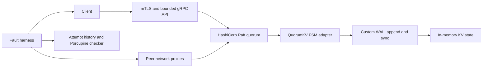

# QuorumKV

A Go replicated key-value service built to answer a practical backend question:
**what can a client safely conclude when a write times out or a replica fails?**

QuorumKV combines a custom write-ahead log and state-machine adapter with
HashiCorp Raft. Its fault harness records individual RPC attempts, including
uncertain writes, and checks observed histories against a sequential KV model.
It is a locally validated case study project, with no production operating claim.

## What I built

- **Durable local state:** CRC-framed WAL, sync before acknowledgement, bounded
  replay, incomplete-tail repair and refusal of complete corrupt records.
- **Replication integration:** committed-command application, quorum-backed reads
  fenced on completed FSM application, snapshot installation and restart.
- **Service boundaries:** mTLS peer/client identity and method permissions,
  bounded requests, conservative client retries and explicit uncertain outcomes.
- **Failure evidence:** process kills, directed network partitions, lost replies,
  exact snapshot-state checks and known-invalid history controls.

HashiCorp Raft supplies consensus, BoltDB persists its log/stable state, and
Jille supplies the peer gRPC transport. The [ownership boundary](docs/RAFT_BOUNDARY.md)
separates those dependencies from this project's engineering.

## Architecture



The separate diagnostics worker consumes bounded evidence outside the request
and consensus paths. It cannot authorize membership, trust or storage changes.

## Reproduce the case study demo

Prerequisites: Go 1.27.3 or newer, writable temporary storage, and free localhost
ports. The tests create disposable synthetic data and stop their own processes.
No Docker, cloud account, model download or existing database is required.

```sh
go test ./test/crashrecovery ./internal/raftnode ./test/securecluster ./test/fault -run '^(TestCrashRecovery_100Trials|TestSnapshotInstallAndRestart|TestProcessMTLSKillLeaderAndRotation|TestRecorderPreservesAppliedWriteWithLostReply|TestChecker_.*)$' -p=1 -count=1 -timeout=180s -v
```

This demonstrates 100 acknowledged-prefix crash trials, exact snapshot recovery,
authenticated process failover and a committed write whose reply is lost. It
also runs controls that reject invalid histories. It is a short validation demo,
not a benchmark. See the [walkthrough](docs/PORTFOLIO_DEMO.md) for expected output
and the [evidence summary](docs/PORTFOLIO_EVIDENCE.md) for the latest run status.

## Engineering decisions worth discussing

| Decision | Why it matters |
|---|---|
| Preserve uncertain writes | A timeout cannot establish that a submitted mutation failed; hiding it weakens the checker. |
| Fence reads on completed application | Being leader or dispatching a committed command does not establish that its value is visible. Default quorum reads do not append to the Raft log. |
| Stop on committed storage failure | An FSM error cannot undo a consensus commit; continuing could serve divergent state. |
| Compare exact restored state | Key counts alone miss wrong values, undeleted keys and stale local state. |

Read the [case study and resume bullets](docs/PORTFOLIO.md),
[claim map](docs/CLAIM_MAP.md) and [design decisions](docs/DECISIONS.md).

## Validation and limits

Candidate validation is local. Earlier hosted CI belongs to the commits recorded
in the [historical verification report](docs/CORRECTNESS_CHECKS.md); it does not
certify this candidate. Passing histories describe recorded finite
executions, and process kills do not test hardware power loss.

Membership is static. There is no verified multi-host availability, sustained
capacity, successful 24-hour endurance run or production deployment. Historical
and experimental performance results are not speedup claims: the optional
larger replication batch failed its read-tail gate, so the default remains one
entry. See [replication batching](docs/REPLICATION_BATCHING.md).

Unfinished receipt-aware journal, command and snapshot experiments are excluded
from this curated candidate and preserved separately in the development workspace.
The public API does not offer exactly-once writes or safe retries of uncertain
mutations. Supported format migration covers KV profiles 0/1 only.
See [candidate scope](docs/CANDIDATE_SCOPE.md).

## Explore the code

| Area | Source |
|---|---|
| WAL and state ownership | [internal/wal](internal/wal/), [internal/store](internal/store/) |
| Replication, read fencing and snapshots | [internal/raftnode](internal/raftnode/) |
| Identity and first-party client | [internal/identity](internal/identity/), [client](client/) |
| Failure harness and history model | [test/fault](test/fault/), [internal/faultproxy](internal/faultproxy/) |
| Process recovery and authenticated failover | [test/crashrecovery](test/crashrecovery/), [test/securecluster](test/securecluster/) |
| Separate diagnostics worker | [diagnostics](diagnostics/) |

The [full demo guide](docs/DEMO.md) includes the broader checks and opt-in
measurement procedure. Performance measurements remain separate from correctness.
